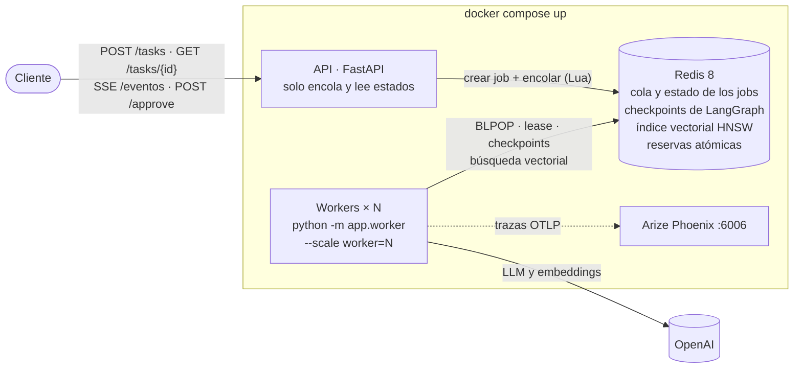
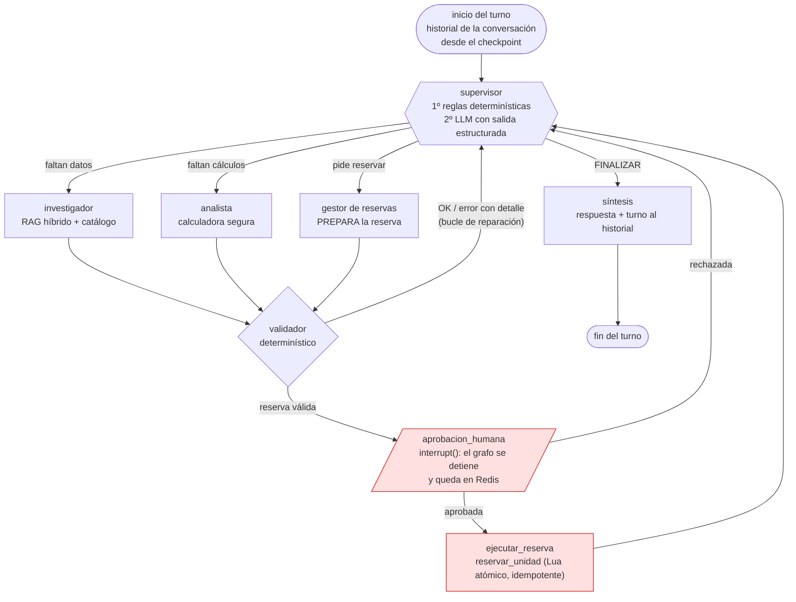
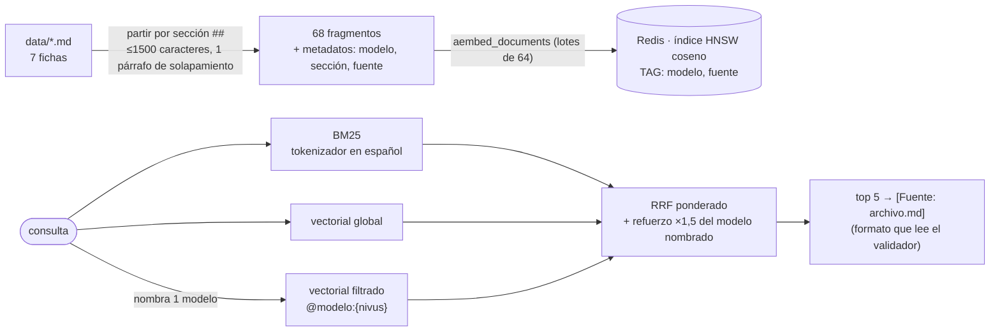

# Sistema Intelligence VW — Entrega final

**AI Engineering — Coderhouse** · Damián Pituello

Sistema multi-agente de producción para consultas técnicas y comerciales sobre
autos **Volkswagen**. Un **Supervisor** de LangGraph coordina especialistas
(investigador, analista y gestor de reservas) que responden con un **RAG
híbrido** sobre las fichas técnicas (BM25 + vectores en Redis + filtro de
metadatos) y con el catálogo de una concesionaria. Todo número pasa por un
**validador determinístico** antes de llegar a la respuesta. El sistema se
expone como una **API asíncrona** (FastAPI). Los **workers son
independientes y escalables**, con leases en Redis. Las **conversaciones
persisten** en el checkpointer de LangGraph y sobreviven a reinicios. Toda
acción con efecto secundario pasa por **aprobación humana**, todas las
fronteras están validadas con **Pydantic** y cada ejecución deja su
**traza en Arize Phoenix** con costo y latencia.

```bash
./run.sh            # Docker es el único requisito: pide la OPENAI_API_KEY si no hay .env y levanta todo
```

API en `http://localhost:8000/docs` · Phoenix en `http://localhost:6006`.

---

## Guía para la evaluación

| Criterio (peso) | Qué se demuestra | Dónde |
|---|---|---|
| **Arquitectura y coherencia** (30 %) | RAG híbrido + Supervisor jerárquico + API profesional + trazabilidad, integrados en un solo flujo; cada decisión de diseño con su alternativa descartada | Secciones [1](#1-arquitectura), [2](#2-el-grafo-de-agentes) y [3](#3-decisiones-de-arquitectura) · `app/graph.py` · `orquestador/rag/` |
| **Robustez técnica** (25 %) | Async de punta a punta (sin `requests` ni llamadas bloqueantes); Pydantic en la API (entrada **y** salida), en las herramientas (entrada **y** salida) y en el estado; Python 3.12 | Secciones [7](#7-api-y-contratos-pydantic) y [12](#12-tests-automatizados) · `app/esquemas.py` · `orquestador/tools/` · `Dockerfile` (`python:3.12-slim`) |
| **Persistencia y observabilidad** (20 %) | Checkpointer de Redis: las conversaciones y las pausas sobreviven a un reinicio; workers que retoman jobs de un worker caído; trazas de cada nodo, agente, herramienta y retriever en Phoenix | Secciones [5](#5-conversaciones-que-sobreviven-a-un-reinicio), [6](#6-workers-independientes-y-escalables) y [9](#9-observabilidad-con-arize-phoenix) · capturas en [`/screenshots`](#10-las-5-pruebas-del-sistema-y-sus-capturas) |
| **Documentación y despliegue** (15 %) | Un solo comando en una máquina limpia (`./run.sh` o `docker compose up`); diagrama del grafo y de la arquitectura en este README | Secciones [1](#1-arquitectura), [2](#2-el-grafo-de-agentes) y [11](#11-cómo-levantarlo) · `docker-compose.yml` · `run.sh` |
| **Entorno y estándares** (10 %) | Python 3.12 (`.python-version`, imagen 3.12), dependencias con versiones fijas (`requirements.lock`), configuración solo por variables de entorno con `.env.example`, sin nombres de modelo ni de índice en el código | Sección [11](#11-cómo-levantarlo) · `orquestador/config.py` · `.env.example` |

**Checklist final de la consigna**

| Ítem | Estado |
|---|---|
| Repositorio que funciona en un clon limpio | ✅ verificado: clon limpio + `docker compose up` + 64 tests con Python 3.12 dentro del contenedor |
| Sin secretos en el código ni en el historial | ✅ `.env` en `.gitignore` y `.dockerignore`; solo se versiona `.env.example`, con las keys vacías |
| Un solo comando | ✅ `./run.sh` (o `docker compose up -d --build`) |
| Diagrama dibujado en el README | ✅ arquitectura (sección 1) y grafo de agentes (sección 2), en Mermaid, que GitHub dibuja |
| Capturas de las 5 pruebas | ✅ `/screenshots`, guía en la sección 10 |
| Python 3.12 | ✅ imagen `python:3.12-slim`, `.python-version`, tests corridos con 3.12.13 |

---

## 1. Arquitectura



El patrón es **FastAPI (recepcionista) → Redis (buzón) → Workers
(especialistas)**. La API nunca corre el grafo: un flujo de agentes tarda
decenas de segundos y un request abierto todo ese tiempo se corta por timeout
y satura el servidor. Los workers son procesos aparte que escalan por su
cuenta. Redis es la **única pieza con estado**, y por eso la API y los
workers se pueden reiniciar, escalar o matar sin perder nada.

Un turno de conversación, de punta a punta:

1. `POST /tasks` valida el pedido (Pydantic), y un **script Lua** guarda el job en `PENDING`, lo registra en la conversación y lo encola, todo de forma atómica. Si la conversación ya tiene un turno en curso, responde **409** (dos turnos sobre el mismo hilo se pisarían).
2. Un worker lo toma (`BLPOP`) y lo **reclama** con otro script Lua: `PENDING → RUNNING` con un **lease** que vence a los `LEASE_S` segundos. Mientras trabaja, lo renueva.
3. Corre el grafo con `thread_id = conversacion_id`: el checkpointer trae el historial de la conversación y guarda un checkpoint después de cada nodo. Cada nodo que termina queda registrado en Redis y sale por `GET /tasks/{id}/eventos` (SSE).
4. El job termina en `DONE` (resultado validado con `ResultadoJob`), `FAILED` (cualquier excepción o timeout) o `WAITING_APPROVAL` (pausa antes de una acción crítica). Al terminar, la conversación acepta el siguiente turno.

## 2. El grafo de agentes



*Diagrama generado del grafo compilado (`get_graph().draw_mermaid()`): [`docs/grafo.png`](docs/grafo.png).*

| Nodo | Responsabilidad | Escribe en el estado (su "parcela") |
|---|---|---|
| `supervisor` | Decide quién sigue y con qué instrucción. Primero aplica **reglas** sin LLM (límite de pasos, bucle de reparación con el error específico, escalado a revisión humana, guardas de suficiencia); si ninguna aplica, decide el **LLM** con una rúbrica y salida estructurada (`Literal` de nombres de nodo). Ve un resumen del estado y los **últimos 3 turnos** de la conversación | `siguiente`, `instruccion`, `pasos`, `decisiones` |
| `investigador` | Agente ReAct (`create_agent`) con dos herramientas: `buscar_en_fichas` (RAG híbrido) y `consultar_catalogo`. Devuelve cada dato con su fuente (`AporteInvestigacion`) | `investigacion`, `evidencia` |
| `analista` | Agente con la calculadora segura (AST, sin `eval`). Solo usa datos validados | `analisis` |
| `reservas` | Prepara la reserva (versión, sucursal, cliente) con herramientas de **solo lectura** | `propuesta_reserva` |
| `validador` | Código, no LLM: cada número tiene que aparecer en la salida cruda de la herramienta que el agente cita; cada cuenta se recalcula; la reserva se valida contra el catálogo y el stock | `validacion`, `validaciones` |
| `aprobacion_humana` | `interrupt()` con el pedido para el revisor | `decision_humana` |
| `ejecutar_reserva` | La única acción con efecto secundario: solo alcanzable desde la aprobación | `resultado_reserva` |
| `sintesis` | Redacta la respuesta con lo validado y agrega el turno al historial | `respuesta_final`, `historial` |

`con_parcela()` verifica en cada paso que un nodo escriba **solo** sus
claves: un agente nunca pisa lo que calculó otro.

## 3. Decisiones de arquitectura

Para quien tenga que mantener o escalar el sistema: qué se eligió, qué se
descartó y cuál es el costo de cada decisión.

| # | Decisión | Alternativa descartada | Por qué | Costo / qué cambiaría a escala |
|---|---|---|---|---|
| 1 | **Supervisor jerárquico con reglas antes que el LLM** | Que el LLM decida todo el ruteo | Los límites (pasos, reparaciones), el escalado y las guardas son invariantes: no pueden depender de que el modelo "se acuerde". Las reglas no gastan tokens y quedan registradas con `origen="regla"` | Más código de control que mantener. Cada regla nueva necesita un test |
| 2 | **Validador determinístico (provenance) como puerta de calidad** | LLM-as-judge | Un modelo puede ser persuasivo y estar equivocado. El validador comprueba con código que cada número exista en la salida cruda de la herramienta citada y recalcula cada cuenta. El error vuelve al agente con el detalle (no un "intentá de nuevo") | Solo valida números y reservas: una afirmación cualitativa errónea no la detecta |
| 3 | **Redis 8 como único backend con estado**: cola, jobs, checkpoints, índice vectorial y reservas | Pinecone (Pre-Entrega 4) + Postgres + RabbitMQ/Celery | La consigna pide levantar todo con un comando en una máquina limpia, sin cuentas externas salvo la del LLM. Redis 8 trae JSON y Search (HNSW): una pieza, un volumen, un healthcheck | Redis es un punto único de falla: en producción, réplica + AOF (ya activado) o Redis gestionado. A millones de vectores, un motor vectorial dedicado |
| 4 | **Cola propia sobre Redis (BLPOP + Lua + leases)** | Celery / arq / RQ | El job tiene un ciclo de vida de dominio (pausa HITL, reanudación, retoma desde checkpoint) que con Celery quedaría repartido entre el broker y el grafo. Con Lua cada transición es atómica y se ve en un solo lugar (`app/jobs.py`) | Hay que mantener las garantías a mano: entrega *at-least-once*, con idempotencia en `reclamar()` y en `reservar_unidad` |
| 5 | **`thread_id` = conversación** y reducer `acumular` (`None` reinicia) | `thread_id = job_id` (Pre-Entrega 7) y memoria en otra base | El checkpointer ya persiste el estado: usarlo como memoria de la conversación da persistencia y reanudación con el mismo mecanismo. Los logs del turno (`decisiones`, `validaciones`, `contribuciones`) se reinician en cada turno; `historial` acumula | Un hilo crece con cada turno: a futuro, resumir o recortar `messages` y `historial` con TTL |
| 6 | **Workers independientes con lease + vigilante** (devolución de la Pre-Entrega 7) | Workers dentro de la API, o recuperar "todo lo que esté RUNNING" al arrancar | Con varios procesos, "lo que está RUNNING al arrancar" puede ser de otro worker vivo. El lease distingue un worker **muerto** de uno **ocupado**; el apagado ordenado (SIGTERM) devuelve el job al instante | Un worker muerto demora hasta `LEASE_S` (30 s) en ser reemplazado. Bajarlo aumenta las escrituras de latido |
| 7 | **RAG híbrido**: BM25 + vectorial global + vectorial filtrado por metadatos, fusionados con **RRF** | Solo vectorial, o solo BM25 (Pre-Entregas 3 y 4) | BM25 encuentra términos exactos ("Latin NCAP", "TSI"); los vectores, las paráfrasis ("¿qué tan seguro es?"). RRF combina **posiciones**, no puntajes en escalas distintas. El filtro por modelo reduce las alucinaciones por contexto ajeno | Una búsqueda más de embeddings por consulta. Ver la evaluación y la limitación conocida en la sección 4 |
| 8 | **HITL garantizado por las aristas del grafo** | Un prompt que diga "pedí aprobación" | `reservar_unidad` no está en las herramientas de ningún agente; `ejecutar_reserva` solo es alcanzable desde `aprobacion_humana`. Es una propiedad estructural, no de comportamiento | Cada acción crítica nueva necesita su nodo y su arista |
| 9 | **Polling + Server-Sent Events** | WebSockets | El progreso es unidireccional (servidor → cliente). SSE funciona sobre HTTP común, pasa por proxies y se prueba con `curl -N` | Lee Redis cada 0,5 s por cliente conectado; a gran escala, Redis Pub/Sub o Streams |
| 10 | **Arize Phoenix self-hosted (OpenTelemetry)** | LangSmith | Los datos no salen de la máquina; corre en el mismo `docker compose`; calcula el costo con los tokens; OpenInference es un estándar abierto (OTLP) | Hay que operarlo (volumen, versión fijada `20.23.0`) |
| 11 | **Config sin defaults para modelos e índices** | Defaults "razonables" en el código | Error a evitar de la consigna (*hard-coding*). Si falta `OPENAI_MODEL`, `EMBEDDINGS_MODEL` o `RAG_INDICE`, el sistema no arranca y el error dice qué agregar | Un `.env` incompleto falla al arrancar, no en silencio (es lo buscado) |
| 12 | **Pydantic en cada frontera** | Diccionarios sueltos | Entrada y **salida** de la API (`response_model`), entrada y salida de cada herramienta, salidas estructuradas de los agentes, y los modelos del estado, que el checkpointer reconstruye con una lista explícita de tipos permitidos (deserializar cualquier clase sería un riesgo de seguridad) | Validar la salida cuesta microsegundos por request |

## 4. RAG híbrido sobre las fichas técnicas



- **Fragmentación por sección con título:** cada fragmento empieza con `Volkswagen Nivus — Seguridad`, así no queda "huérfano" de su contexto (la búsqueda vectorial y el LLM saben de qué auto habla).
- **Índice versionado** (lección de la Pre-Entrega 4, donde un cambio de esquema dejó vectores viejos mezclados): el índice guarda una **huella** = versión del esquema + modelo de embeddings + hash del contenido. Si cambian las fichas o el modelo, se reconstruye solo al arrancar. Si arrancan 3 workers a la vez, un **lock en Redis** hace que indexe uno solo (verificado con Redis real: la segunda llamada reutiliza el índice en 4 ms).
- **Degradación controlada:** si la API de embeddings falla, la búsqueda sigue con BM25 y lo deja en los metadatos (`modo: "solo_bm25 (búsqueda vectorial caída)"`) y en la traza. Con `EMBEDDINGS_PROVIDER=ninguno` funciona sin embeddings.
- **Es un `BaseRetriever` de LangChain:** en Phoenix aparece como span **RETRIEVER** con los 5 documentos, su sección y su puntaje.

**Evaluación** (`scripts/evaluar_rag.py`): 20 preguntas con la sección
correcta conocida. La mitad usa las palabras de la ficha y la otra mitad son
paráfrasis. *acierto@5* = la sección correcta está entre los 5 fragmentos que
recibe el investigador.

| Embeddings | Búsqueda | acierto@1 | acierto@5 | MRR |
|---|---|---|---|---|
| `paraphrase-multilingual-MiniLM-L12-v2` (local, calibración) | solo BM25 | 60 % | 75 % | 0,66 |
| `paraphrase-multilingual-MiniLM-L12-v2` (local, calibración) | **híbrido** | 55 % | **95 %** | **0,69** |
| `text-embedding-3-small` (el del sistema, corrida real) | solo BM25 | 60 % | 75 % | 0,66 |
| `text-embedding-3-small` (el del sistema, corrida real) | **híbrido** | **60 %** | **85 %** | **0,70** |

*Corrida real: `docker compose exec worker python scripts/evaluar_rag.py`, 26/10/2026, reporte en
`evidencia/evaluacion_rag_20261026_193223.json`.*

- **Con los embeddings del sistema, el híbrido mejora en todas las métricas:** el acierto@5 sube de 75 % a 85 %, el acierto@1 se mantiene en 60 % y el MRR pasa de 0,66 a 0,70.
- Recupera **paráfrasis** que BM25 pierde por completo: "¿Dónde se fabrica el Taos?" (puesto 5), "¿Qué autos compiten con el Nivus?" (puesto 2) y "¿Qué lugar ocupa el Virtus dentro de la gama Volkswagen?" (puesto 3).
- También sube posiciones en preguntas que BM25 ya encontraba: "¿Cómo le fue al Polo en las pruebas de choque?" pasa del puesto 2 al 1, y "¿Qué versiones del Taos se venden?" del 1 al 2 (el único caso en que baja un puesto, sin salir del top 5).
- Dos paráfrasis no las encuentra ninguna de las dos búsquedas con `text-embedding-3-small`: "¿Qué tan seguro es el Tera en un choque?" y "¿Por qué dejó de venderse el Vento?". El modelo local de la calibración sí las encontraba. En el sistema completo, esto pesa menos que en la evaluación: el investigador reescribe la consulta antes de buscar, y el prompt le pide incluir el modelo y los términos de la ficha (por ejemplo, "Latin NCAP ocupante adulto Tera"). Eso es justamente lo que verifica la prueba 1 de la sección 10, y la traza lo muestra: el span RETRIEVER de esa prueba recibió `Latin NCAP ocupante adulto Tera`, no la pregunta original, y el primer documento recuperado fue la sección de seguridad del Tera, con el 89,88 % ([`screenshots/01_rag_hibrido.png`](screenshots/01_rag_hibrido.png)).
- `k = 5` y los pesos (1, 1, 1) con refuerzo 1,5 salieron de una búsqueda en grilla con el modelo local. Con k = 4 el híbrido llegaba al 90 %; k = 6 no mejoraba nada.
- **Limitación conocida (la trampa de la Pre-Entrega 4):** "capacidad de baúl de la **versión sedán del Polo**". La respuesta está en la ficha del **Virtus** (el sedán derivado del Polo). BM25 la encuentra en el puesto 4, pero el híbrido refuerza la ficha del Polo, que es el modelo nombrado, y la deja afuera. Pasa con los dos modelos de embeddings, y ninguna combinación de pesos la recupera sin perder aciertos en las otras 19 preguntas. Es el costo del filtro por metadatos: se acepta porque gana 3 preguntas y pierde 1. La solución de fondo sería un mapa de sinónimos de modelo ("sedán del Polo" → Virtus) antes de filtrar.

## 5. Conversaciones que sobreviven a un reinicio

```bash
# Turno 1: sin conversacion_id empieza una conversación nueva
curl -X POST localhost:8000/tasks -H "Content-Type: application/json" \
     -d '{"tarea": "Cuantos CV tiene el Nivus Sense segun el catalogo?"}'
# -> {"job_id": "...", "conversacion_id": "7fb1cdee-...", "estado": "PENDING", ...}

# Turno 2: misma conversacion_id. "ese" se resuelve con el turno anterior
curl -X POST localhost:8000/tasks -H "Content-Type: application/json" \
     -d '{"tarea": "Y cuantos CV mas que ese tiene el Taos?", "conversacion_id": "7fb1cdee-..."}'

curl localhost:8000/conversaciones/7fb1cdee-...      # los turnos, con sus respuestas
```

- **Dónde vive la memoria:** en el checkpointer de LangGraph (`AsyncRedisSaver`), bajo `thread_id = conversacion_id`. Cada turno corre sobre el mismo hilo: la síntesis agrega un `Turno(pregunta, respuesta, job_id)` al `historial`, y el supervisor y la síntesis ven los últimos 3. El supervisor resuelve las referencias ("ese", "¿y en Córdoba?") en instrucciones **autocontenidas** para los especialistas, que nunca ven la conversación (aislamiento de contexto).
- **Qué se reinicia en cada turno:** las decisiones, validaciones y contribuciones son del turno. El reducer `acumular` suma como `operator.add`, pero un `None` en la entrada del turno las vacía. Sin eso, el límite de pasos y el bucle de reparación del turno 2 contarían lo que pasó en el turno 1.
- **Por qué sobrevive:** la API y los workers no guardan nada en memoria. `docker compose restart api worker` entre dos turnos no cambia nada (prueba 6, sección 10). Redis tiene AOF activado (`--appendonly yes`), así que tampoco se pierde con `docker compose down` y `up`.
- **Un turno a la vez por conversación:** `POST /tasks` con una conversación que tiene un turno en curso responde **409** con el `job_activo`. Un turno que terminó en `FAILED` libera la conversación.
- **Idempotencia por turno:** la clave de idempotencia de la reserva pasó de ser el `thread_id` (Pre-Entrega 7) a ser el `job_id`. El hilo ahora es la conversación, que puede tener una reserva por turno; el mismo turno re-ejecutado nunca reserva dos veces (hay un test para esto).

## 6. Workers independientes y escalables

Respuesta a la devolución de la Pre-Entrega 7: en `docker compose` la API corre con
`WORKER_EN_PROCESO=false` y los workers son un servicio aparte.

```bash
docker compose up -d --scale worker=3       # 3 procesos × WORKERS=5 tareas asyncio = 15 jobs en paralelo
curl localhost:8000/health                  # workers_vivos: uno por contenedor, con su modo de RAG y su LLM
```

| Situación | Qué pasa | Mecanismo |
|---|---|---|
| Un mensaje duplicado en la cola, o dos workers con el mismo job | Lo ejecuta uno solo | `reclamar()`: script Lua que solo pasa `PENDING → RUNNING` |
| `docker compose stop worker` / SIGTERM a mitad de un job | El job vuelve a la cola **al instante** y otro worker lo retoma desde el último checkpoint | Apagado ordenado: `CancelledError` → `devolver_a_la_cola()` |
| `kill -9`, corte de luz, OOM | A los `LEASE_S` segundos (30 por defecto), el vigilante de otro worker lo devuelve a la cola | Lease con vencimiento, renovado cada `LEASE_S/3`. El vigilante solo toma leases **vencidos** |
| Dos vigilantes ven el mismo lease vencido | Se encola una sola vez | Script Lua que comprueba y encola en un solo paso |
| Arrancan 3 workers juntos con un índice desactualizado | Indexa uno solo; los demás esperan y lo reutilizan | Lock `SET NX EX` + huella del índice |

**Verificado de punta a punta** (contenedores de la API, Redis y Phoenix, con
2 procesos worker y un LLM simulado, porque el comportamiento no depende del
modelo):

```
SIGTERM al worker después del primer validador:
  PENDING  job creado y encolado
  RUNNING  iniciar (vm-7080/w3)
  PENDING  apagado ordenado de vm-7080/w3: se retoma desde el último checkpoint
  RUNNING  continuar (vm-7082/w1)
  DONE     respuesta lista                       (7,6 s después de la señal)

kill -9 al worker después del primer validador (LEASE_S=9):
  RUNNING  iniciar (vm-7081/w2)
  PENDING  el lease del worker venció: se retoma desde el último checkpoint
  RUNNING  continuar (vm-7082/w1)
  DONE     respuesta lista                       (el investigador NO se volvió a ejecutar:
                                                  siguió desde el checkpoint posterior)
```

## 7. API y contratos Pydantic

| Método | Ruta | Entrada → Salida (`app/esquemas.py`) |
|---|---|---|
| `POST` | `/tasks` | `PedidoTarea` → **202** `TareaCreada` (`job_id`, `conversacion_id`, `consultar`, `eventos`) · **409** si la conversación tiene un turno en curso · **422** si no valida |
| `GET` | `/tasks/{job_id}` | → `EstadoJob`: estado, historial, `ResultadoJob` (respuesta, turno, fuentes, decisiones con su origen y razón, reserva), `PedidoAprobacion` o error |
| `GET` | `/tasks/{job_id}/eventos` | → `text/event-stream`: eventos `estado`, `paso` (cada nodo del grafo, en vivo) y `fin` |
| `GET` | `/tasks` | → `list[ResumenJob]` |
| `POST` | `/tasks/{job_id}/approve` | `DecisionHumana` → **202** `RespuestaAprobacion` · **409** si no espera aprobación (o ya se aprobó) |
| `GET` | `/conversaciones/{id}` | → `Conversacion` (turnos en orden + turno activo) |
| `GET` | `/health` | → `Salud`: Redis, largo de la cola y **workers vivos** de todos los contenedores |

```bash
curl -N localhost:8000/tasks/<job_id>/eventos
# event: paso
# data: {"nodo": "supervisor", "detalle": "decide 'investigador' (llm): Faltan los datos de potencia..."}
# event: paso
# data: {"nodo": "validador", "detalle": "investigador: OK"}
# ...
# event: fin
# data: {"estado": "DONE", "respuesta": "El Virtus Exclusive tiene 49 CV más..."}
```

**Pydantic en todas las fronteras:**

- **API:** cada endpoint declara `response_model`. FastAPI valida lo que entra (422) y también lo que **sale**: un job con un campo inválido falla en el servidor en vez de llegarle roto al cliente. `conversacion_id` se valida con un patrón porque termina dentro de claves de Redis. Hay un test que verifica en el esquema OpenAPI que cada endpoint tenga su modelo.
- **Herramientas:** entrada con `args_schema` (lo que ve el LLM) y salida armada desde un modelo antes de serializarse: `ResultadoBusqueda` (fuente con patrón `archivo.md`), `ResultadoCatalogo` (stock ≥ 0), `ResultadoCalculo` (resultado finito), `ReservaConfirmada` (sucursal real; también se valida lo que vuelve de Redis).
- **Agentes:** salida estructurada (`AporteInvestigacion`, `AporteAnalisis`, `PropuestaReserva`, `DecisionSupervisor`). El supervisor y la síntesis son cadenas **LCEL** (`ChatPromptTemplate | modelo`).
- **Worker:** arma `ResultadoJob` y `PedidoAprobacion` antes de guardarlos en Redis: los datos se validan al escribirse, no recién al leerse.

**Async de punta a punta** (errores a evitar de la consigna):

- No hay `requests`, `time.sleep` ni clientes sincrónicos en el código async. Redis va con `redis.asyncio`, el LLM y los embeddings con `ainvoke` / `aembed_*`, el índice vectorial con `redisvl.AsyncSearchIndex` y el checkpointer con `AsyncRedisSaver`.
- BM25 es un cálculo en memoria sobre 68 fragmentos (microsegundos): no hace I/O ni bloquea el event loop.
- El recuperador implementa solo `_aget_relevant_documents`: llamarlo de forma sincrónica es un error explícito.

## 8. Human-in-the-loop

Reservar una unidad compromete stock real, así que nunca lo decide sola una
IA. La garantía es **estructural** (decisión 8): el gestor de reservas solo
prepara la reserva; el validador la contrasta con el catálogo y el stock;
`aprobacion_humana` llama a `interrupt()` y el grafo queda en Redis (puede
pasar una hora, o reiniciarse todo); `POST /tasks/{id}/approve` registra la
decisión de forma atómica y encola la reanudación; el worker retoma el mismo
hilo con `Command(resume=decision)`. La reserva es un script Lua que controla
el stock (5 pedidos simultáneos por la última unidad → se reserva una sola,
test con Redis real) y es idempotente por `job_id`.

```bash
python scripts/demo_hitl.py            # pide una reserva, muestra el pedido de aprobación y pregunta
```

## 9. Observabilidad con Arize Phoenix

```
orquestador (AGENT, raíz · session.id = conversacion_id · metadata: job_id, llm, rag, prompts v6)
└── LangGraph
    ├── supervisor → agente_supervisor (AGENT) → ChatPromptTemplate → ChatOpenAI (LLM: tokens, costo)
    ├── investigador → agente_investigador (AGENT)
    │                  ├── ChatOpenAI
    │                  ├── buscar_en_fichas (TOOL) → RecuperadorHibrido (RETRIEVER: 5 documentos con sección y puntaje)
    │                  └── consultar_catalogo (TOOL)
    ├── validador (sin LLM)
    ├── analista → agente_analista (AGENT) → ChatOpenAI → calculadora (TOOL)
    ├── reservas → aprobacion_humana → ejecutar_reserva → reservar_unidad (TOOL)
    └── sintesis → agente_sintesis (AGENT) → ChatPromptTemplate → ChatOpenAI → StrOutputParser
```

- **Una sesión de Phoenix por conversación:** la pestaña **Sessions** muestra cada conversación como turnos (pregunta → respuesta), con los tokens, el costo y la latencia de cada uno. Un job con aprobación humana suma dos trazas (antes y después de la pausa) en la misma sesión.
- **Metadata en cada traza:** `job_id`, `conversacion_id`, LLM, modo del RAG (híbrido o solo BM25), y la **versión y huella de los prompts** (`v6`). Si un cambio de prompt rompe el ruteo, la traza dice con qué versión se generó cada corrida.
- La telemetría HTTP de FastAPI está apagada a propósito: si no, los ~5 ms de cada `GET` del polling se mezclan con las ejecuciones y distorsionan el p95 (hallazgo de la Pre-Entrega 7).
- Phoenix se inicializa al arrancar cada proceso, **antes** de crear los agentes (error común: instrumentar tarde).

## 10. Las 5 pruebas del sistema y sus capturas

```bash
python scripts/pruebas_sistema.py              # las 5 pruebas, con el LLM real
python scripts/pruebas_sistema.py --reinicio   # + la 6: reinicia la API y los workers entre dos turnos
```

Cada prueba verifica algo concreto (no solo que "respondió") e imprime el link
a su **sesión en Phoenix**, que es lo que se abre para la captura. El
resultado queda en `evidencia/pruebas_sistema_<fecha>.json`.

| # | Prueba | Qué verifica | Captura |
|---|---|---|---|
| 1 | **RAG híbrido con paráfrasis**: "¿Qué tan seguro es el Tera en un choque?" | El dato validado sale de `tera.md` y la respuesta cita Latin NCAP, aunque la pregunta no tiene esas palabras | [`01_rag_hibrido.png`](screenshots/01_rag_hibrido.png): el span **RecuperadorHibrido** (RETRIEVER) con la consulta reescrita y los documentos recuperados |
| 2 | **Supervisor + especialistas**: CV y Nm del Virtus Exclusive vs. Tera High | Intervienen investigador y analista; la diferencia es 49 CV | [`02_supervisor_especialistas.png`](screenshots/02_supervisor_especialistas.png): la secuencia de nodos y la jerarquía analista → agente → `calculadora` / `ChatOpenAI`, con la metadata de la traza |
| 3 | **Conversación de dos turnos**: "Nivus Sense" → "¿y cuántos CV más que ese tiene el Taos?" | 409 si se pide el turno 2 antes de tiempo; el turno 2 resuelve "ese" (49 CV) | [`03_conversacion.png`](screenshots/03_conversacion.png): la sesión en **Sessions**, con los 2 turnos |
| 4 | **Human-in-the-loop**: reservar una Saveiro Extreme en Córdoba | Se detiene en `WAITING_APPROVAL`; la reserva se ejecuta recién después de aprobar | [`04_hitl.png`](screenshots/04_hitl.png): la sesión con las 2 trazas, la pausa ("¿Aprobás…?") y la reanudación con la reserva confirmada |
| 5 | **Puerta de calidad**: un cálculo corrompido a propósito | El validador lo rechaza, el analista vuelve a intervenir y la respuesta final es la correcta | [`05_puerta_de_calidad.png`](screenshots/05_puerta_de_calidad.png): el bucle de reparación en el árbol (el `supervisor` de 2 ms es la regla) · [`05b_validador_rechaza.png`](screenshots/05b_validador_rechaza.png): el `validador` con `"ok": false` y el error específico |
| 6 | **Reinicio** (`--reinicio`): turno, `docker compose restart api worker`, turno | El turno 2 corre en procesos nuevos y recuerda el turno 1 | [`06_reinicio.png`](screenshots/06_reinicio.png): los 2 turnos de la conversación, antes y después del reinicio |

Además:
- [`07_tests.png`](screenshots/07_tests.png): los 64 tests en verde, con Python 3.12;
- [`08_carga_escalado.png`](screenshots/08_carga_escalado.png): la prueba de carga de la sección 13 con 3 workers (`/health` con los 3 procesos y el bloque de concurrencia);
- [`09_metrics_phoenix.png`](screenshots/09_metrics_phoenix.png): la pestaña **Metrics** de Phoenix con las dos corridas de carga.

### Resultados de la corrida real

`python scripts/pruebas_sistema.py --reinicio` con `gpt-4o-mini`, prompts `v6` y RAG híbrido
(`text-embedding-3-small`), el 26/10/2026. **6/6 pruebas OK y 26/26 chequeos.** Es la corrida de
las capturas; el reporte completo es [`evidencia/pruebas_sistema_20261026_154827.json`](evidencia/pruebas_sistema_20261026_154827.json).

| # | Prueba | Latencia | Qué hizo el sistema |
|---|---|---|---|
| 1 | RAG híbrido con paráfrasis | 7,6 s | La pregunta no dice "Latin NCAP" y el investigador encontró la sección igual: **89,88 %** de ocupante adulto, validado contra `tera.md`. Una sola intervención: el supervisor finalizó sin pedir cálculos |
| 2 | Supervisor + especialistas | 26,3 s | investigador → analista → FINALIZAR: **49 CV y 80 Nm** más, con fuentes del catálogo y de las fichas `tera.md` y `virtus.md` |
| 3 | Conversación de dos turnos | 11,2 s + 19,6 s | El turno 2 pedido antes de tiempo recibió **409**. En el turno 2, el analista calculó con un dato faltante (0); la regla de datos faltantes mandó al investigador a buscar el Nivus y el analista rehízo la cuenta: **49 CV**, sin escalado |
| 4 | Human-in-the-loop | 15,4 s | Pausa en `WAITING_APPROVAL`; aprobación de Damián por `POST /approve`; reserva **R-30E98FD1** confirmada después de la aprobación |
| 5 | Puerta de calidad | 13,5 s | El validador rechazó el cálculo corrompido a propósito; una regla reenvió al analista su output con el error específico; respuesta final correcta (**49 CV**) sin escalado |
| 6 | Reinicio | 6,8 s + 21,0 s | `docker compose restart api worker` entre los turnos. Los workers arrancaron de nuevo (18:43:17 → 18:47:57 UTC) y el turno 2, "¿Y en la sucursal Córdoba?", entendió que se seguía hablando del Taos 1.4 TSI |

**Lectura de la corrida:**

- **La regla de datos faltantes ya trabaja en producción:** apareció en 2 de los 6 escenarios (pruebas 3 y 6). En los dos, el turno terminó bien y sin escalar.
- **Ineficiencia observada:** en el turno 2 de la prueba 6, el supervisor pidió un análisis que la pregunta no requería ("diferencia de unidades entre sucursales"). No afecta la respuesta, pero suma ~10 s y 2 intervenciones. Lo mismo pasó con el analista "de más" en el turno 1 de la prueba 3. Es candidato para la regla de finalización de la sección 17. Se ve también en los tokens: el turno 2 de la prueba 3 usó 12.677 tokens, contra 6.295 del turno 1, por la vuelta extra analista → investigador → analista.
- **Lo que muestran las capturas:**
  - **Reescritura de la consulta (prueba 1):** el span RETRIEVER recibió `Latin NCAP ocupante adulto Tera`, no la pregunta original; el investigador la reescribió con los términos de la ficha.
  - **La latencia es del LLM (prueba 2):** de los 26,2 s de la traza, 10,7 s fueron **una sola** llamada a `ChatOpenAI` del analista, y las dos `calculadora` tardaron 1 ms cada una. Es la variabilidad de la API de OpenAI: la misma consulta tardó 14,1 s en la corrida anterior.
  - **La pausa persiste el estado (prueba 4):** la reanudación usó 1.948 tokens y 3,2 s, contra 7.518 tokens y 11,5 s antes de la pausa. No repitió la investigación ni la propuesta: siguió desde el checkpoint en Redis.
  - **La reparación es una regla (prueba 5):** en el árbol, el `supervisor` que reenvía al analista su error tarda **2 ms** (los demás, 1,4–1,8 s): decidió una regla, sin llamar al LLM. El validador distingue los dos tipos de error: acá `numeros_sin_respaldo` está vacío (una cuenta mal hecha → se repara al analista); en la prueba 3 tenía el dato faltante (→ se manda al investigador).
- **Las corridas anteriores también quedaron como evidencia** (en [`evidencia/corridas_anteriores/`](evidencia/corridas_anteriores/)): cada una encontró un problema real que hoy está corregido y documentado en la sección 15.

## 11. Cómo levantarlo

**Un comando, en una máquina limpia** (solo Docker):

```bash
git clone https://github.com/Pituello/EntregaFinal && cd EntregaFinal
./run.sh                 # Linux, macOS o Git Bash en Windows. ./run.sh 3 -> con 3 workers
```

Sin `run.sh`, a mano:

```bash
cp .env.example .env     # completar OPENAI_API_KEY
docker compose up -d --build
```

Al arrancar, el worker indexa las 7 fichas en Redis (68 embeddings, unos
segundos y una fracción de centavo). Los arranques siguientes reutilizan el
índice por su huella.

| Para | Comando |
|---|---|
| Ver los logs de los workers | `docker compose logs -f worker` |
| Escalar | `docker compose up -d --scale worker=3` |
| Correr los tests dentro del contenedor (Python 3.12, sin instalar nada) | `docker compose run --rm -e REDIS_URL_TESTS=redis://redis:6379/0 api python -m pytest -q` |
| Evaluar el RAG con los embeddings reales | `docker compose exec worker python scripts/evaluar_rag.py` |
| Volver a llenar el stock de reservas | `docker compose exec redis sh -c "redis-cli --scan --pattern 'vw:reserva*' \| xargs -r redis-cli del"` |
| Apagar (los datos quedan en los volúmenes) | `docker compose down` |
| Borrar todo, incluidos los datos | `docker compose down -v` |

**Desarrollo local** (Python 3.12 en un venv; Redis y Phoenix en Docker):

```bash
docker compose up -d redis phoenix
py -3.12 -m venv venv && source venv/Scripts/activate     # Linux/macOS: python3.12 -m venv venv && source venv/bin/activate
python -m pip install -r requirements.txt
python -m pytest -q                                        # 64 tests, sin API key
uvicorn app.main:app --port 8000                           # con WORKER_EN_PROCESO=true en el .env
```

**Variables de entorno:** todas están en `.env.example`, comentadas. Las
obligatorias sin default en el código son `OPENAI_API_KEY`, `OPENAI_MODEL`,
`EMBEDDINGS_MODEL` y `RAG_INDICE`. Si falta una, el proceso no arranca y el
error dice cuál agregar.

> En Git Bash (Windows), `curl` manda las tildes en la codificación de Windows y la
> API responde `There was an error parsing the body`. Por eso los ejemplos van sin
> tildes. Los scripts de `scripts/` mandan UTF-8 siempre, y también se puede usar `/docs`.

## 12. Tests automatizados

```bash
python -m pytest -v        # 64 tests · sin API key ni Docker · 4 de integración con Redis real (se saltean si no hay)
```

| Archivo | Tests | Qué cubre |
|---|---|---|
| `tests/test_orquestador.py` | 26 | El grafo con agentes dobles y evidencia real: delegación, validación de procedencia, bucle de reparación, **datos faltantes → investigador** y **nunca finalizar con un análisis rechazado** (regresiones de las corridas reales), escalado, límites, aislamiento de parcelas, calculadora segura |
| `tests/test_api.py` | 15 | API asíncrona, estados en Redis, FAILED por excepción y por timeout, 5 jobs concurrentes que no se bloquean, retoma desde checkpoint, HITL completo, reservas atómicas e idempotentes |
| `tests/test_produccion.py` | 13 | **Entrega final:** conversaciones (memoria, reinicio de logs por turno, 409, liberación tras FAILED, GET /conversaciones), idempotencia de la reserva por turno, mensaje duplicado, apagado ordenado, renovación del lease, workers vivos en `/health`, eventos SSE, `response_model` en cada endpoint, **la conversación sobrevive a un reinicio con Redis real** |
| `tests/test_rag.py` | 10 | **Entrega final:** fragmentación con metadatos, RRF, ranking filtrado por modelo, degradación a BM25 si caen los embeddings, contratos de la herramienta, huella del índice, variables obligatorias, **indexación única con 2 procesos y filtro TAG en Redis real** |

Los tests no dependen del `.env` de cada máquina: `tests/conftest.py` completa
las variables obligatorias con valores de prueba, y los agentes y los
embeddings son dobles (`DeterministicFakeEmbedding`), así que corren gratis y
siempre igual.

## 13. Prueba de carga y escalado

```bash
python scripts/prueba_carga.py --limpiar             # 5 concurrentes (la de la Pre-Entrega 7)
python scripts/prueba_carga.py --n 20 --limpiar      # alta concurrencia
```

Atiende la segunda sugerencia de la devolución: medir latencia y costo **bajo
alta concurrencia**. Con más jobs que slots de workers, la latencia de punta a
punta mezcla dos cosas distintas. El script las separa: **espera en cola**
(se arregla escalando workers) y **ejecución del grafo** (se arregla con
menos llamadas o tokens del LLM). También mide la cola máxima, el throughput,
cuántos jobs corrió cada worker, el costo por job (p50/p95), la proyección
cada 1.000 consultas y el desglose de tokens y tiempo por agente leído de
Phoenix. Guarda todo en `evidencia/prueba_carga_n<N>_<fecha>.json`.

Corrida real del 26/10/2026, `gpt-4o-mini`, 20 peticiones concurrentes (las 5 consultas de la
Pre-Entrega 7, 4 veces cada una). Primero con 1 worker y después con
`docker compose up -d --scale worker=3`. Reportes: `evidencia/prueba_carga_n20_20261026_161859.json`
y `evidencia/prueba_carga_n20_20261026_162032.json`.

| Métrica (`--n 20`) | 1 worker (5 slots) | **3 workers (15 slots)** |
|---|---|---|
| Los 20 POST respondieron en | 92 ms | 150 ms |
| Tiempo total de la prueba | 53,8 s | **26,8 s** |
| Throughput | 22,3 jobs/min | **44,8 jobs/min** |
| Cola máxima | 15 jobs | 5 jobs |
| **Espera en cola** p50 / p95 | 19,4 s / 40,1 s | **0,1 s / 11,9 s** |
| Ejecución del grafo p50 / p95 | 13,0 s / 14,5 s | 12,7 s / 14,5 s |
| **Latencia de punta a punta** p50 / p95 | 32,5 s / 52,6 s | **13,8 s / 24,6 s** |
| Jobs por proceso worker | 20 | 7 · 6 · 7 |
| Costo por job p50 / p95 (Phoenix) | USD 0,00135 / 0,00176 | USD 0,00125 / 0,00176 |
| Costo promedio · proyección | USD 0,00142 · USD 1,42 cada 1.000 consultas | USD 0,00136 · USD 1,36 cada 1.000 consultas |
| Fallidos | 0 | 0 |

**Lectura de la prueba:**

- **Escalar workers ataca la espera en cola, no la ejecución.** La ejecución del grafo es la misma con 1 o 3 workers (p95 = 14,5 s en los dos casos). Lo que cambió fue la espera en cola: p50 de 19,4 s a 0,1 s. Con 5 slots, 20 jobs necesitan 4 "tandas" de ~13 s (53,8 s en total); con 15 slots, 2 tandas (26,8 s). El throughput se duplicó y el p95 de punta a punta bajó a menos de la mitad.
- **El reparto entre workers es parejo (7 · 6 · 7)** sin ningún balanceador: cada worker toma de la misma cola de Redis cuando tiene un slot libre (`BLPOP`).
- **La concurrencia no encarece ni degrada cada job:** costo por job y tiempo de ejecución iguales con 5 o 15 jobs a la vez. El costo es estable entre corridas (USD 0,0014 por consulta, igual que en la Pre-Entrega 7), aunque ahora el investigador recibe fragmentos del RAG híbrido.
- **Hallazgo de observabilidad: el p95 de Phoenix no ve la cola.** Phoenix mide la latencia de las trazas, es decir, la ejecución del grafo (p95 = 14,5 s en las dos corridas). El usuario, en cambio, espera la cola más la ejecución (p95 = 52,6 s con 1 worker). Un dashboard que mire solo Phoenix diría que el sistema está sano mientras los usuarios esperan casi un minuto. Por eso el script mide las dos latencias por separado, desde los tiempos que guarda la API en Redis. En producción, la espera en cola (o el largo de la cola, que expone `GET /health`) es la señal para escalar.
- **Dónde se va el tiempo y el costo:** el 96–98 % del tiempo de las trazas es espera del LLM. El supervisor hace 3 llamadas por job (60 de 160) y se lleva la mayor parte del tiempo (~97 s de LLM por corrida); el investigador, la mayor parte de los tokens (37 %), por los fragmentos de las fichas y el catálogo que entran a su contexto. Finalizar por regla (sección 17) ahorraría una de las 3 llamadas al supervisor.

*Referencia de la Pre-Entrega 7 (5 concurrentes, un proceso): p95 = 16,8 s ·
USD 0,0014 por ejecución · 98 % del tiempo de las trazas es espera del LLM.*

## 14. Errores comunes evitados

| Error (consigna y apuntes) | Cómo se evita |
|---|---|
| *Hard-coding* de nombres de modelo o de índices | `OPENAI_MODEL`, `EMBEDDINGS_MODEL` y `RAG_INDICE` obligatorios en el `.env`, sin default en el código; `.env.example` completo |
| `requests` sincrónico dentro de `async def` | Todo con clientes async (`redis.asyncio`, `ainvoke`, `aembed_*`, `AsyncSearchIndex`, `AsyncRedisSaver`); el recuperador no tiene versión sincrónica |
| Sistema sin trazas | Cada nodo, agente, herramienta, retriever y llamada al LLM en Phoenix; sesión por conversación |
| Bloquear el event loop / ejecutar IA en el endpoint | La API solo encola; el grafo corre en workers aparte |
| Ignorar errores en background | Toda excepción o timeout → `FAILED` con el error; el job nunca queda colgado |
| No persistir el estado inicial | Crear y encolar es un solo script Lua |
| `MemorySaver` en producción | `AsyncRedisSaver`; conversaciones y pausas sobreviven a reinicios |
| Efectos antes del `interrupt()` | `aprobacion_humana` no tiene efectos; la reserva vive en el nodo siguiente |
| Supervisor infinito / bucle de corrección infinito | `MAX_PASOS` y `MAX_REPARACIONES` como reglas, con escalado a revisión humana |
| Mezclar datos en Phoenix | `--limpiar` vacía el proyecto antes de medir |
| Versionado del índice vectorial | Huella de esquema + modelo + contenido; se reconstruye solo |

## 15. Hallazgos durante el desarrollo

| Problema | Causa | Corrección |
|---|---|---|
| **Primera corrida real de las pruebas del sistema** ([reporte](evidencia/corridas_anteriores/1_escalado_en_conversacion.json)): el turno 2 de la conversación ("¿y cuántos CV más que ese tiene el Taos?") respondió bien (49 CV), pero terminó **escalado a revisión humana** después de 2 reparaciones del analista | El supervisor le pidió al investigador solo el Taos. El analista usó el 101 del Nivus que venía del turno 1, y el validador lo rechazó con razón: no estaba validado en este turno. Reparar al analista con los mismos datos no podía funcionar | **Regla nueva del supervisor:** si al análisis le faltan datos (`numeros_sin_respaldo`), va al **investigador** a buscarlos, una vez por turno, en vez de reparar al analista. El prompt del supervisor (v6) pide los datos de todos los modelos de una comparación. `pruebas_sistema.py` ahora también exige que no haya escalado: el chequeo del 49 solo lo había dejado pasar |
| **Segunda corrida real** ([reporte](evidencia/corridas_anteriores/2_analisis_rechazado_en_la_respuesta.json)): con la regla nueva, el turno 2 respondió *"el Taos tiene 150 CV más"*, un número incorrecto sin ningún aviso | El analista calculó `150 - 0` porque le faltaba el dato del Nivus. La regla mandó bien al investigador a buscarlo, pero después el LLM del supervisor eligió FINALIZAR sin rehacer el análisis, y la síntesis usó la cuenta rechazada: el resumen del estado mostraba el análisis igual, haya pasado o no la validación | **Guarda nueva:** nunca se finaliza si el último análisis del turno fue rechazado; el analista lo rehace con la investigación actual. Además, el resumen que ven el supervisor y la síntesis marca ese análisis como `ANÁLISIS RECHAZADO POR EL VALIDADOR`. Era un agujero de la puerta de calidad que existía desde la Pre-Entrega 6: un resultado rechazado podía llegar al usuario si el LLM finalizaba en el momento justo |
| Al probar el `docker compose`, cada worker cortaba su conexión con `Timeout reading from redis:6379` cada 5 s | **redis-py 8** cambió el `socket_timeout` por defecto a 5 s, igual que la espera del `BLPOP` de la cola. Con fakeredis no se veía | `conectar()` en `app/jobs.py` fija un `socket_timeout` mayor que la espera de la cola |
| El índice vectorial no se creaba sin salida a internet al arrancar | `OpenAIEmbeddings` descarga el tokenizador de tiktoken para partir textos largos | `check_embedding_ctx_length=False`: los fragmentos (≤ 1500 caracteres) entran de sobra en el contexto del modelo |
| Con `thread_id` = conversación, el turno 2 habría arrancado con el límite de pasos ya gastado (detectado al diseñar las conversaciones) | Con `operator.add`, las decisiones y validaciones del turno 1 se suman a las del turno 2 | Reducer `acumular`: `None` en la entrada del turno reinicia los logs; `historial` sigue acumulando |
| La reserva del turno 2 de una conversación habría devuelto la del turno 1 (detectado al diseñar) | La clave de idempotencia era el `thread_id`, que ahora es la conversación | La clave pasó a ser el `job_id` (test de regresión) |
| Al reanudar después de un reinicio, `'dict' object has no attribute 'version_id'` (Pre-Entrega 7) | El checkpointer devuelve como diccionarios los modelos Pydantic que no se declaran | `checkpointer_redis()` declara los tipos del estado en el serializador (msgpack y JSON) |
| **Tercera corrida real** ([reporte](evidencia/corridas_anteriores/3_reserva_sin_stock.json)): la prueba 4 (HITL) falló con *"no quedan unidades de Saveiro Extreme cabina doble en Córdoba (stock del catálogo: 2, ya reservadas: 2)"* | No era un error: el **control de stock atómico** funcionó. Las dos corridas anteriores de la prueba ya habían reservado las 2 unidades, y la tercera reserva, aprobada por el humano, se rechazó sin descontar nada; la síntesis lo informó tal cual. La prueba no era repetible | `pruebas_sistema.py` repone el stock ficticio de la demo (borra las reservas en Redis) antes de la prueba 4 |
| La trampa "sedán del Polo" se pierde con el híbrido | El refuerzo del modelo nombrado favorece la ficha del Polo | Limitación documentada (sección 4) |

## 16. Estructura del repositorio

```
├── app/                      # la capa de producción
│   ├── main.py               # FastAPI: endpoints, SSE, lifespan
│   ├── esquemas.py           # contratos Pydantic de la API
│   ├── jobs.py               # cola, estados, conversaciones, leases (scripts Lua)
│   ├── worker.py             # workers independientes: reclamar, latido, vigilante, apagado ordenado
│   ├── graph.py              # el grafo del Supervisor + checkpointer de Redis
│   ├── hitl.py               # aprobación humana (interrupt) + POST /approve
│   ├── observability.py      # Phoenix (OpenInference) + span raíz por ejecución
│   └── traza.py              # ejecución con log de decisiones (Pre-Entrega 6)
├── orquestador/              # el sistema multi-agente
│   ├── agents/               # supervisor (LCEL), investigador, analista, reservas, síntesis (LCEL)
│   ├── rag/                  # documentos (fragmentación), indice (Redis HNSW), recuperador (híbrido), servicio
│   ├── tools/                # buscar_en_fichas, consultar_catalogo, calculadora, reservar_unidad
│   ├── state.py              # estado, reducers y modelos Pydantic
│   ├── validation.py         # validador determinístico
│   ├── prompts.py            # prompts versionados (v6)
│   ├── llm.py · config.py    # proveedor de LLM y configuración (solo por variables de entorno)
│   └── trazado.py            # decorador @agente
├── scripts/
│   ├── pruebas_sistema.py    # las 5 pruebas con el LLM real y links a Phoenix
│   ├── prueba_carga.py       # N concurrentes + métricas de concurrencia y costo
│   ├── evaluar_rag.py        # BM25 vs híbrido sobre 20 preguntas
│   └── demo_hitl.py
├── tests/                    # 64 tests (conftest.py los independiza del .env)
├── data/                     # fichas técnicas de los 7 modelos
├── docs/grafo.{mmd,png}      # el grafo generado del grafo compilado
├── screenshots/ · evidencia/ # capturas y reportes JSON de las corridas
├── docker-compose.yml · Dockerfile · run.sh
├── requirements.txt          # rangos compatibles
├── requirements.lock         # versiones exactas (las usa la imagen)
├── .env.example · .python-version (3.12) · .gitattributes
└── README.md
```

## 17. Limitaciones conocidas y próximos pasos

- **Sinónimos de modelo en el RAG** ("sedán del Polo" → Virtus), para recuperar la trampa sin perder el filtro por metadatos.
- **Recorte de la memoria:** el hilo de una conversación crece con cada turno. El supervisor ve solo los últimos 3, pero el checkpoint guarda todos; convendría resumir los turnos viejos o ponerles TTL.
- **Finalizar por regla:** la tercera llamada al supervisor casi siempre decide FINALIZAR. Una regla ("investigación y análisis validados, nada pendiente") ahorraría ~1/3 de sus llamadas (hallazgo del dashboard de la Pre-Entrega 7).
- **Autenticación de la API:** no la pide la consigna. En producción, una API key o un token por cliente, y que la conversación pertenezca a quien la creó.
- **Redis como punto único de falla:** réplica o servicio gestionado en producción.
